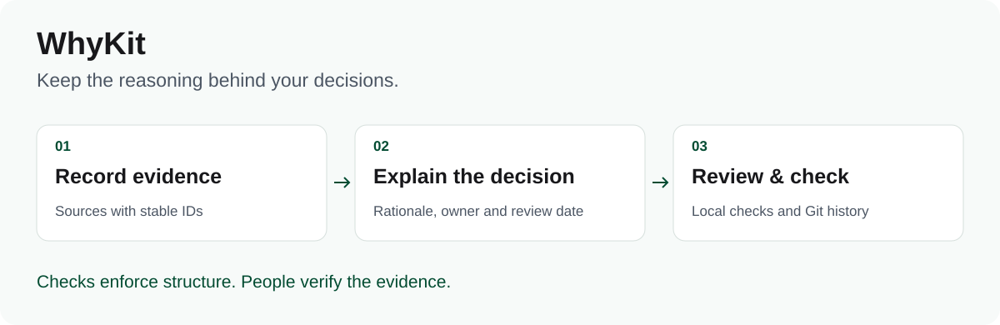

# WhyKit

**Remember why a decision was made — and know what to revisit.**

A decision can look sound in a document long after its supporting evidence has changed. WhyKit connects important decisions to named sources and makes their review state inspectable. When you explicitly retire or replace a source in the ledger, you can trace which decisions still cite it.

WhyKit is a **Git-native, Markdown-based evidence and decision ledger**: readable and editable files, a CLI and checks, with optional read-only access for AI tools through MCP. No hosted account or model is required.

**A concrete scenario:** a small team chooses agencies as its first customer segment, citing interviews and a market analysis. Months later, the team registers new research and marks the earlier source as replaced. WhyKit can identify the decision's reference to the retired source so a person can revisit the rationale. It does **not** collect the research, monitor prices or markets, judge whether the decision was right, or automatically change it.

- **For a first real workflow:** [trace an evidence change through a GTM decision](docs/use-cases/evidence-change.md).
- **For technical teams:** [record, review and supersede a decision](docs/tutorials/record-and-supersede.md).
- **For AI tooling:** [expose the records through read-only MCP](docs/mcp.md). Access to the records does not establish that an agent will reason correctly.



**Python 3.11+ · No core runtime dependencies · Apache-2.0**

**Status:** public alpha. Source version: `0.4.0`. Check [PyPI](https://pypi.org/project/whykit/) for the installed release; the published package may be older than the source. The quickstart below documents a published 0.3.4-compatible workflow. Some 0.4 features remain preview or experimental: [feature status](docs/feature-status.md), [upgrade and recovery](docs/migration-0.4.md).

Keep sensitive vaults private. WhyKit's sensitivity filters are **not** access controls. [See when plain ADRs are sufficient](docs/project-positioning.md).

[](https://github.com/CometWeb-io/whykit/actions/workflows/ci.yml)

## Try it

Install [uv](https://docs.astral.sh/uv/getting-started/installation/) (0.13.4+)
and use Python 3.11+. This example works with the published 0.3.4 release and
uses a fictional source. It creates a
folder called a *vault*: just the Markdown files WhyKit works with.

<!-- quickstart:start -->
```bash
uv tool install whykit

# Create a vault.
whykit init my-ledger

# Record a source, then a draft decision that cites it.
whykit new --root my-ledger evidence \
  --source "Support ticket export, Q3" --type dataset \
  --location "https://example.com/exports/q3-tickets.csv" \
  --claims "Most onboarding tickets mention SSO"
whykit new --root my-ledger decision "Ship SSO before audit logs" \
  --owner Platform --status draft --source E-001

# See the connection, then check the vault.
whykit trace --root my-ledger --decision D-001
whykit lint --root my-ledger
whykit review --root my-ledger list --due-days 120
```
<!-- quickstart:end -->

The trace shows the decision and its source:

```text
D-001  06-decisions/d-001-ship-sso-before-audit-logs.md  (draft)
    E-001 active
```

`D-001` is the decision; `E-001` is the source it cites. The decision is
still a draft: open its Markdown file and replace the prompts with your actual
context, choice, reasons, alternatives and consequences before
[approving it](docs/guide.md#approve-a-decision).

The lint check reports five expected warnings: one for the unfinished decision
and four for unanswered questions in the vault's `AGENTS.md`. Answer those
questions before letting an agent write to the vault or enabling the strict CI
gate. Replace the starter content before treating the vault as authoritative.
This draft is not yet listed for review, so the review list is empty.

If `whykit` is not found, run `uv tool update-shell` and open a new terminal.
Use `uv tool upgrade whykit` to update an existing installation. For development
or the optional Explorer, see [running from a checkout](docs/guide.md#run-whykit-from-a-checkout).

## What would you like to do?

- **Record a decision and revisit it later:** [record, check and supersede a decision](docs/tutorials/record-and-supersede.md).
- **Bring existing notes or ADRs:** [adopt existing Markdown](docs/guide.md#already-have-a-pile-of-markdown).
- **Review a changed source and share a filtered export:** [import, review and export](docs/tutorials/review-and-export.md).
- **Give an AI tool read-only context:** [connect the MCP server](docs/mcp.md).
- **Check decisions in pull requests:** [set up a GitHub Actions gate](docs/tutorials/gate-pull-requests.md).

## How it works

```text
source (E-001) → decision and reasons (D-001) → review
```

WhyKit connects the records, checks their structure and reports review dates.
When a decision changes, you can record a successor instead of overwriting the
accepted reasoning. An optional Git check can flag edits to accepted records.

WhyKit does **not** determine whether a source is true or a decision is right.
It does not check external sources for changes on its own. Sensitivity labels
and filtered outputs are not a substitute for repository access permissions.
[See when plain ADRs are a better fit](docs/project-positioning.md).

## Documentation

- [Start here](docs/README.md) · [Concepts](docs/concepts.md) · [How-to guides](docs/guide.md)
- [Command reference](docs/cli.md) · [Configuration](docs/configuration.md) · [Lint rules](docs/rules.md)
- [CI integration](docs/ci.md) · [MCP server](docs/mcp.md) · [Troubleshooting](docs/troubleshooting.md)
- Example vaults: [tiny](examples/tiny/) and [Northline](examples/northline/)

[Contributing](CONTRIBUTING.md) · [Code of Conduct](CODE_OF_CONDUCT.md) ·
[Security policy](SECURITY.md) · [Release checklist](.github/RELEASE.md)

Copyright 2026 Maciej Zmitrukiewicz (hello@cometweb.io), licensed under
[Apache-2.0](LICENSE). [CometWeb](https://cometweb.io) is the product name, not
the copyright holder.
