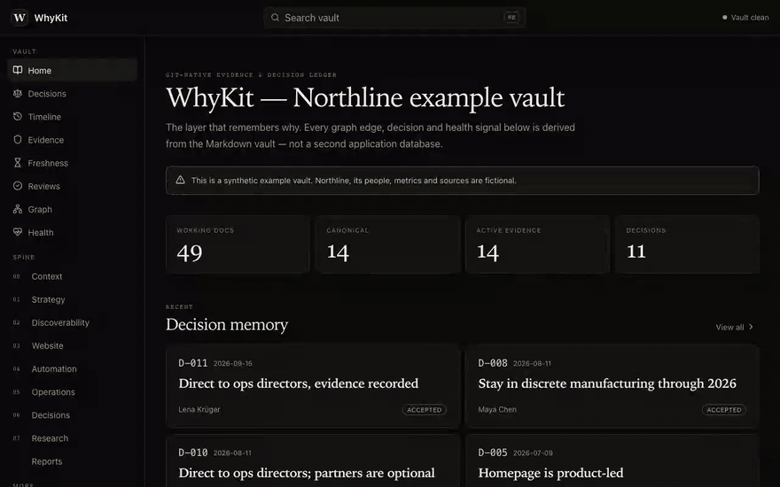

<div align="center">

# WhyKit

### Know which decisions a change touches, and which of them need another look.

Your coding agent sees the code, not the reasons behind it, so it "fixes"
things that were deliberate. WhyKit keeps decisions and their sources as plain
Markdown in Git, maps every change to the decisions that govern it, and flags
the ones whose evidence or review has gone out of date: in the pull request,
before merge, and for Claude Code, Cursor or Codex before they edit.

[](https://github.com/CometWeb-io/whykit/actions/workflows/ci.yml)
[](https://pypi.org/project/whykit/)
[](https://pypi.org/project/whykit/)
[](https://opensource.org/licenses/Apache-2.0)
[](https://securityscorecards.dev/viewer/?uri=github.com/CometWeb-io/whykit)
[](https://whykit.cometweb.io/)

**No runtime dependencies · Offline by design · Your data stays Markdown**

[Live demo](https://whykit.cometweb.io/demo/) · [Tutorial](docs/tutorials/catch-decision-drift.md) · [Connect agents](docs/agents.md) · [Docs](docs/README.md) · [Roadmap](ROADMAP.md)



</div>

## What it does

Each decision cites its sources (`E-001`) and declares the code it governs
(`applies_to: ["src/payments/**"]`). Before a change lands, one command answers
*which decisions does this touch, and has anything they rest on changed?*

```console
$ whykit affected --root examples/payments --today 2026-11-12 \
    --files src/payments/ledger.py src/webhooks/refunds.py README.md
WhyKit affected — 3 changed files · 2 decisions apply · 1 needs review · 1 file not covered by any decision
  D-001  review   Store money as integer cents
      files: src/payments/ledger.py
      - a cited source was retired
  D-003  applies  Make every webhook handler idempotent
      files: src/webhooks/refunds.py
  not covered by any decision: README.md
  1 live decision(s) declare no applies_to scope: D-005
```

That is real output from the synthetic [payments example](examples/payments/);
a test keeps this block in step with the code. The ledger decision rests on an audit checklist
that has since been replaced, so its reasoning needs a look before this change
merges. WhyKit says what it checked and what it did not: uncovered files and
unscoped decisions are listed, and it never claims a change is safe.


- **Sources** get stable IDs and can be retired or replaced; captured sources
  are pinned by their bytes.
- **Decisions** cite sources, declare their scope, carry an owner and a review
  date, and are append-only: you supersede, you don't rewrite.
- **Changes** are mapped to decisions by `whykit affected`, locally, in CI and
  by agents, with review signals for retired, missing, stale or changed
  sources (including source files the change itself modifies) and overdue or
  failed reviews. Scopes can be suggested from Git history.
- **Agents** read the same files through a read-only MCP server, and
  `whykit connect` tells them to ask before they edit.

## Try it

Install [uv](https://docs.astral.sh/uv/getting-started/installation/) (0.13.4+)
and use Python 3.11+. This creates a *vault*, a folder of Markdown files, with
one source and one draft decision that cites it:

<!-- quickstart:start -->
```bash
uv tool install whykit

# Create a vault.
whykit init my-ledger

# Record a source, then a draft decision that cites it.
whykit new --root my-ledger evidence \
  --source "Support ticket export, Q3" --type dataset \
  --location "https://example.com/exports/q3-tickets.csv" \
  --claims "Most onboarding tickets mention SSO"
whykit new --root my-ledger decision "Ship SSO before audit logs" \
  --owner Platform --status draft --source E-001

# See the connection, then check the vault.
whykit trace --root my-ledger --decision D-001
whykit lint --root my-ledger
whykit review --root my-ledger list --due-days 120
```
<!-- quickstart:end -->

The trace shows the decision and the source it cites:

```text
D-001  06-decisions/d-001-ship-sso-before-audit-logs.md  (draft)
    E-001 active
```

The lint check reports five expected warnings: one for the unfinished draft
and four for unanswered questions in the vault's `AGENTS.md`. Fill in the
draft's context, options and consequences, then
[approve it](docs/guide.md#approve-a-decision). If `whykit` is not found, run
`uv tool update-shell` and open a new terminal.

## Catch decision drift

Declare what each decision governs, then ask about any change, planned or
committed:

```bash
whykit new --root my-ledger decision "Store money as integer cents" \
  --owner Payments --status draft --source E-001 --applies-to 'src/payments/**'
whykit affected --root my-ledger --files src/payments/ledger.py   # before you edit
whykit affected --root my-ledger --base origin/main --format markdown   # in a pull request
```

Don't want to write scopes by hand? Let Git suggest them from the commits that
changed each decision or name it in their message, then confirm:

```bash
whykit scope suggest --root my-ledger            # preview
whykit scope suggest --root my-ledger --write    # fill in decisions without a scope
whykit scope check --root my-ledger --strict     # in CI: fail when a scope points at code that moved
```

A source kept in the repository (a benchmark, a spec) counts too: when a pull
request modifies it, every decision citing it is flagged.

Decisions about a library or a convention can watch for words instead of
paths: with `watch_terms: ["moment"]`, a change that adds `import moment`
surfaces the "Use Luxon" decision. An agent can send its planned patch before
applying it. We [replayed real ADR repositories](docs/field-evaluation.md) to
tune this, and publish what did not work too.

Already have ADRs? Skip the vault and point it at the folder; scopes are
inferred from the paths each ADR mentions, and moved code is flagged:

```bash
whykit affected --adr docs/decisions --base origin/main
```

The [ten-minute tutorial](docs/tutorials/catch-decision-drift.md) goes from an
empty repository to a flagged decision and its successor; every command in it
runs in the test suite. [Affected decisions](docs/affected.md) covers scope
patterns, every signal and a pull-request workflow.

## Connect your agents

One command prints the MCP configuration for your host and adds a short,
marked block to your code repository's `CLAUDE.md` or `AGENTS.md` telling the
agent to look up decisions before it changes what they cover:

```bash
uv tool install --upgrade 'whykit[mcp]'
whykit connect --root my-ledger --host claude-code          # preview
whykit connect --root my-ledger --host claude-code --write  # apply
```

Hosts: `claude-code`, `cursor`, `vscode`, `codex`, `claude-desktop` and
`generic`. The server is read-only with eight tools (`query`, `context`,
`impact`, `status`, `pack`, `trace`, `backlinks`, `affected`); records above your chosen
sensitivity ceiling are never returned. The instruction block also tells the
agent to call `affected` on the files it plans to change. `whykit connect`,
`whykit affected` and the `affected` tool are new in 0.5.0;
the MCP server itself is in 0.4.0.
[Read the agent guide](docs/agents.md).

## Gate pull requests

Instructions ask; CI enforces. On a pull request, the GitHub Action fails when
an accepted decision's reasoning is rewritten, a cited source is missing or a
credential slips into the vault:

```yaml
- uses: actions/checkout@3d3c42e5aac5ba805825da76410c181273ba90b1 # v7.0.1
  with:
    fetch-depth: 0
- uses: CometWeb-io/whykit@<reviewed-40-character-commit-sha>
  with:
    root: decisions
    profile: ci
    affected: "true"   # add the decisions this change touches to the job summary
```

See [gate pull requests](docs/tutorials/gate-pull-requests.md) for the full
workflow and a good and a bad example, and [CI integration](docs/ci.md) for
PR comments, SARIF and other CI systems.

## What would you like to do?

- **See it on a real-looking vault:** [live Explorer demo](https://whykit.cometweb.io/demo/) of the payments example.
- **Record a decision and change your mind later:** [record, check and supersede](docs/tutorials/record-and-supersede.md).
- **Bring existing notes or ADRs:** [adopt existing Markdown](docs/guide.md#already-have-a-pile-of-markdown).
- **Browse the vault in a web UI:** [run the Explorer](docs/guide.md#browse-the-vault-in-the-explorer).
- **Edit in Obsidian or your editor:** [Obsidian](docs/obsidian.md) · [language server](docs/editors.md).
- **Review a changed source and share a filtered export:** [import, review and export](docs/tutorials/review-and-export.md).

## Why WhyKit

| | Plain ADRs | Wiki / Notion | WhyKit |
|---|---|---|---|
| Lives next to the code, in Git | ✓ | | ✓ |
| Maps a code change to the decisions that govern it | | | ✓ |
| Flags decisions whose sources were retired, replaced or changed | | | ✓ |
| Review dates that expire and get reported | | | ✓ |
| Rewriting accepted decisions blocked in CI | | | ✓ |
| Read-only MCP access for agents, sensitivity-filtered | | | ✓ |
| Works offline, no account, no service | ✓ | | ✓ |

Already happy with ADRs? Keep them; [here is when they are the better fit](docs/project-positioning.md).
When you outgrow them, `whykit adopt --profile adr-only` brings them in.

## Built to be trusted

- **Plain files are canonical.** Every view (queries, graphs, MCP, the
  Explorer) is derived from Markdown you can read and diff.
- **Nothing phones home.** No telemetry, accounts or network calls; a test
  breaks the socket layer and runs every vault command.
- **A stable machine contract.** Every `--json` output has a published
  [JSON Schema](schemas/); error codes and exit codes are documented in the
  [automation contract](docs/automation.md).
- **Tested hard.** About 1,800 tests, property and fuzz tests for the parsers,
  reproducible builds, an SBOM and OpenSSF Scorecard on every release.

## Limits, stated plainly

WhyKit checks that reasoning is cited, dated and not rewritten. It does
**not** decide whether a source is true or a decision is right, and it does
not re-check external sources on its own. Sensitivity labels filter what the
MCP server and exports return; they are not access control, so keep real
vaults in private repositories. `whykit affected` matches files by path, not
by meaning, and sees only changes recorded in the vault. Agent instructions are
a request: pair them with the CI gate. The project is a public alpha; see the
[feature status](docs/feature-status.md) and the
[0.4 upgrade guide](docs/migration-0.4.md).

## Documentation

- [Start here](docs/README.md) · [Concepts](docs/concepts.md) · [How-to guides](docs/guide.md) · [Connect agents](docs/agents.md) · [Affected decisions](docs/affected.md)
- [Command reference](docs/cli.md) · [Configuration](docs/configuration.md) · [Lint rules](docs/rules.md)
- [CI integration](docs/ci.md) · [MCP server](docs/mcp.md) · [Troubleshooting](docs/troubleshooting.md)
- Example vaults: [payments](examples/payments/), [tiny](examples/tiny/) and [Northline](examples/northline/)

## Contributing

Issues and pull requests are welcome. Start with [CONTRIBUTING.md](CONTRIBUTING.md);
the whole suite runs offline with the standard library. If WhyKit is useful to
you, a ⭐ helps other people find it.

[Contributing](CONTRIBUTING.md) · [Code of Conduct](CODE_OF_CONDUCT.md) ·
[Security policy](SECURITY.md) · [Release checklist](.github/RELEASE.md) ·
[Changelog](CHANGELOG.md) · [Roadmap](ROADMAP.md)

Copyright 2026 Maciej Zmitrukiewicz (hello@cometweb.io), licensed under
[Apache-2.0](LICENSE). [CometWeb](https://cometweb.io) is the product name, not
the copyright holder.
